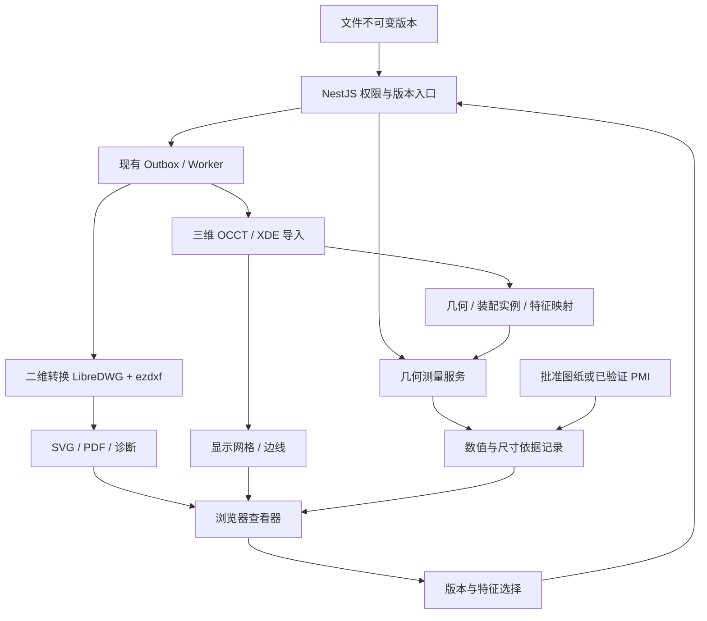

# CAD 工程测量实施方案与分阶段任务

- 日期：2026-10-13；主责：wmj；状态：方案待评审，开发任务均未完成。
- 决策：[ADR-032](adr/ADR-032-CAD工程测量与尺寸依据.md)；历史：[ADR-031](adr/ADR-031-CAD预览通道.md)、[PR #323](https://github.com/256-code/LibiaoLink/pull/323)。
- 范围：CAD 预览、工程几何查询、尺寸依据关联及追溯。实物采集、自动合格判定和 CAD 编辑不在本期。
- wmj 主责 CAD 前后端、契约及方案；共享 file/preview/outbox 改动由 lan 协办评审，部署与通用 UI 由 px 协办评审。具体修改先对齐共享边界，不改动其他模块归属。

## 1. 目标与首个交付

一个指定版本的 STEP 模型能够查询限定的工程尺寸、关联批准图纸，并保存可回溯记录。旋转、居中、爆炸及显示网格精度不改变几何结果；缺少单位或依据时不得伪装成可加工/验收的尺寸要求。

公差、常用源格式、典型模型规模、硬件并发和预算未知；先收集样本再冻结精度/性能指标。计划中的格式、接口与字段均未落地，不可据此编写“已支持”发布说明。

## 2. 数据流与职责

NestJS 保存权限与业务语义，几何进程负责导入和计算；对象存储保存源文件及版本化模型包，数据库保存状态和关联。几何服务通过内部受控调用接收模型字节，不持数据库凭据、不暴露公网；缓存只提升性能，不能越过文件权限。

模型包：几何恢复文件、零件定义、实例树与原始变换、网格/边线、特征映射、单位/诊断、清单。首期可采用分件显示网格，具体传输编码经 CAD-1 验证冻结，不能丢失三角形到 CAD 面的映射。清单在必需产物齐备后发布；显示成功和工程测量可用分别报告。

## 3. 能力边界

| 能力 | 首期规则 |
|---|---|
| STEP/STP | 主验证格式；根据几何、单位和实例映射逐项开放测量 |
| IGES/IGS | 独立读取分支；有曲面不等于有有效实体，按能力诊断开放 |
| STL/3MF/OBJ/glTF/GLB | 实际实现 loader 后开放参考预览；纯网格不默认工程可测 |
| DWG/DXF | 模型空间/布局预览，保留完整范围和诊断，关联批准图纸 |
| 专有原生格式 | 先由设计端导出 STEP + 批准图纸；直接导入需评估 SDK |
| 工程测量 | 解析圆/圆柱、顶点距离、平行面间距、定义明确的中心/轴线距离及角度 |
| 参考测量 | 网格拾取、自由点及拟合结果；不能当作公差依据 |
| PMI | 区分图形和语义；按类型验证，不以“可显示”证明语义正确 |

二维输出需带布局与诊断，缺字体/外参须明确显示；MAD 只参与初始视口。原始批准 PDF 与自动转换 PDF 分别标识。二者不能只凭文件名推定同一批准版本，需显式关联确认。

## 4. 拟定契约与数据口径（CAD-2 冻结后才进入 shared）

路径均以现有 `/api/v1` 为前缀；以下是设计草案，不是已提供的 API。

| 方法与路径 | 语义 |
|---|---|
| GET /files/{id}/cad?versionId=… | 权限校验后获取状态、能力和短时可访问产物清单；未生成时按现有模式幂等投递 |
| POST /files/{id}/cad/measure | 输入 versionId、importId、operation、instanceId 与 featureId；临时计算，不自动保存 |
| POST /files/{id}/cad/measurements | 保存服务端可复算结果与尺寸依据关联，使用幂等键；不信任客户端数值/操作者 |
| GET /files/{id}/cad/measurements?versionId=… | 只返回有权访问的指定版本记录，不自动迁移新版本 |

preview 响应需要可区分的 CAD viewer 类型；旧 ONLYOFFICE 分支保持兼容。能力诊断与任务状态独立：可预览不等于可工程测量。当前 target=image 的三维直签仅为旧实现，不作为新契约设计依据。

| 概念 / 拟定字段 | 口径 |
|---|---|
| fileId / versionId | 服务端校验真实文件和版本归属；历史版本按其真实格式路由 |
| importId | 绑定源哈希、依赖摘要、引擎与导入配置；重新导入可生成新标识 |
| partDefinitionId / instanceId | 几何定义与实例分离；每实例保存源装配变换 |
| featureId | CAD 顶点/边/面标识，仅在 importId 内稳定 |
| sourceUnit / unitResolution | 保留源单位及确认依据；未知则阻止相关工程计算 |
| operation / value / unit | 定义明确的计算种类、未按显示位数截断的数值、规范单位 |
| methodVersion / diagnostics | 计算版本、导入/测量异常；算法容差不是整体精度保证 |
| basisVersionId / locator | 批准图纸版本与页码/尺寸号，或已验证 PMI 标识 |
| nominal / tolerance / datum | 来自设计依据，不能从几何值推定；几何公差须结构化定义，不能统用一个 ± 数字 |
| confirmation / actor / time | 服务端权限控制的确认与留痕；与实物合格状态分开 |

数据库候选聚合为导入记录、源版本到产物关联、测量记录及依据确认记录；具体表名/DDL、对象清理、依据撤销、归档与删除策略在 CAD-2 评审，本文不预分配迁移号。

缓存依赖闭包应纳入字体、CTB、外参等实际影响结果的输入。任务失败分类复用既有 retry/dead 机制；确定性失败不无限重试；修复转换参数后产生新版本而不覆盖旧结果。保存后的工程记录不能因缓存淘汰而失去源版本及复算依据。

## 5. 已合入内容的更正清单

以下均为 PR #323 基线的源码/文档核对，未执行运行时回放。历史提交与 Push 285 不改写；本节为追加更正。

| 编号 | 原描述 / 问题 | 当前事实与处理 | 开发任务 |
|---|---|---|---|
| C01 | 小于 1 的长度 | value×1000 后仍标 mm，量纲分支不一致 | CAD-0.1 |
| C02 | STEP/IGES 均支持 | IGES 调用 ReadStepFile，应独立验证 ReadIgesFile | CAD-0.2 |
| C03 | 白名单等于支持格式 | OBJ/glTF/GLB 未实现 loader；STEP 加载还需核对 BASE_URL 相对 URL 定位 | CAD-0.2 |
| C04 | 层级装配树、高亮、线框 | 当前为平面列表与显隐；完整层级、高亮、线框入口未实现 | CAD-3.1 |
| C05 | 工程测量、非圆面可靠拒绝 | 网格距离和近共面点拟圆，无工程误差上限；拟合阈值不能证明真圆 | CAD-0.1、CAD-3.2 |
| C06 | 测量不受展示影响 | 爆炸移动测量坐标；ΔXYZ 是显示坐标分量，不等同源坐标 | CAD-0.1、CAD-3.2 |
| C07 | 懒加载使主线程只渲染 | ReadStepFile 仍在主线程，动态 import 不等于 Worker | CAD-0.3 |
| C08 | PoC 已证明可交付 | 两份引用报告未在仓库找到；历史数值不能直接作为当前验收证据 | CAD-1.1 |
| C09 | 一次转换双产物天然支持 | 现有转换调用只返回一个产物，需要显式协调与清单发布 | CAD-2.2 |
| C10 | 浏览器 DWG 不可行；预转不能视锥加载；商业与内网冲突 | 均为过强结论，ADR-032 已按官方资料修正 | 本次文档修订 |
| C11 | WASM 动态链接免除业务代码相关许可义务 | 需按依赖版本与分发方式核对，不作笼统保证 | CAD-1.3 |

## 6. 分阶段开发任务

所有任务当前均为未开始；“文档已整理”不表示开发卡片完成。wmj 主责全部 CAD 卡片，表中协办按共享边界参与。每卡片附变更范围、实际验证结果和剩余问题，再按非作者评审合并。

| ID | 阶段 / 任务 | 前置 | 交付与验收 | 协办评审 |
|---|---|---|---|---|
| CAD-0.1 | 修正单位、隔离参考测量 | 无 | 0.5 mm 不再显示为 500 mm；不明单位禁止工程标签；爆炸时参考距离有明确限制；移除工程可靠性暗示 | px |
| CAD-0.2 | 校准加载与格式清单 | 无 | IGES 独立 reader、WASM 基址正确；未实现格式撤出可预览白名单；历史版本按版本后缀；最小真实样本可打开 | lan、px |
| CAD-0.3 | 参考查看器生命周期 | 0.2 | 保留浏览器解析则放 Worker；关闭/切换可取消，迟到结果丢弃，释放几何/材质/Worker | px |
| CAD-1.1 | 样本与验收口径 | 无，可与 0 并行 | 明确源格式、最小公差、批准依据、硬件并发；样本编号/哈希/预期值及来源；补录或说明旧 PoC 缺失 | lan、px |
| CAD-1.2 | 几何服务原型 | 1.1 的代表样本 | OCCT 导入与恢复、源单位、重复实例、圆孔/面距、特征映射可复现；与源 CAD 同定义结果比较 | lan |
| CAD-1.3 | 选型对照与版本锁定 | 1.2 | 记录开源路线结果；必要时商业 SDK 同样本比较；未取得试用/报价则标未验证；锁定依赖与分发义务 | lan、px |
| CAD-2.1 | 契约与存储设计 | 1 达标 | 冻结能力/错误状态、viewer 兼容、模型包、字段及生命周期；新增迁移与 shared 生成物同批评审 | lan、px |
| CAD-2.2 | 导入任务与产物发布 | 2.1 | 复用 outbox；依赖摘要幂等；中途失败不出现完整 ready；旧产物可追溯；资源与任务限额 | lan、px |
| CAD-3.1 | 浏览器接入模型包 | 2.2 | 装配树按实例显隐；选择面/边映射及高亮正确；版本/单位/能力状态可见 | px |
| CAD-3.2 | 限定工程测量 | 3.1 | 逐项支持范围；原始坐标计算；爆炸/旋转/LOD 不改结果；未知单位/无效特征明确拒绝 | lan、px |
| CAD-4.1 | 尺寸依据与保存 | 3.2 | 批准图纸版本关联、服务端复算与幂等保存、确认权限和留痕、换版不静默迁移 | lan、px |
| CAD-4.2 | 首条业务链验收 | 4.1 | STEP → 几何值 → 图纸公差 → 保存 → 重开追溯完整；只提供 PMI 的业务需先完成 5.2 必需子集 | lan、px |
| CAD-5.1 | 二维转换与保真（承接 M4-06） | 1.1、2.2，可与 3/4 并行 | 布局/字体/外参/CTB 诊断、完整范围、SVG/PDF 产物、与批准原件区分；关键标注逐样本核对 | lan、px |
| CAD-5.2 | PMI 与格式扩展 | 1、实际需求 | 语义与图形 PMI 分开验收；每新增格式提交能力矩阵及依据，不能仅追加后缀 | lan、px |
| CAD-5.3 | 大装配体性能 | 3、实测瓶颈 | 固定硬件样本记录冷/热加载、峰值内存和测量延迟；按瓶颈增加分件/LOD，不设臆测 MB 阈值 | lan、px |

阶段门禁：CAD-0 消除已知误导；CAD-1 决定选型与指标；CAD-2～3 建成工程几何查询；CAD-4 完成尺寸依据链；CAD-5 按需求扩展。若公差或批准依据尚未明确，可继续预览工作，但不能宣称工程验收通过。

## 7. 聚焦验证与交付

- 数值：小于 1、毫米/英寸、未知单位；解析圆与非圆曲线；平行面和方向相反的法向；算法定义一致的源 CAD 对照。
- 实例与显示：重复零件、旋转实例、跨零件距离；原始/爆炸/不同显示精度结果一致，ΔXYZ 使用明确的坐标系。
- 版本与权限：历史格式变更、重新导入、伪造 instance/feature/version、换版后旧记录、无权访问关联依据；测试限本功能边界。
- 任务与恢复：失败重试不重复发布，产物缺失不可测量，热缓存淘汰后可恢复几何且记录可复算。
- 二维：关键尺寸、公差、中文、布局、字体、CTB 与外参；不以“文件能打开”判定合格。
- 精度与性能阈值：CAD-1 按实际业务确定并记录来源；内核容差、显示位数、测量误差分别说明。
- 本轮为纯文档：只核对差异、链接与状态，不运行代码静态检查或全量构建。后续开发验证只覆盖受影响链路，不扩为无关全仓审计。

## 8. 文档同步与未关闭项

同步入口：ADR 索引、ADR-008/031 更正说明、技术设计 v0.1/v0.2/v0.3、前端功能需求、字段对照、系统功能书 D3、团队分工与开发日志。历史日志保留，用新增更正记录说明差异。

《系统功能书》引用的外部 V1.0 源文档本次未取得可编辑来源，仓库内 D3 已同步，本次不能声明“双处同步完成”；由 CAD 主责协调文档维护者补齐源文档，作为独立待办，不影响本次方案评审。

尚未关闭：实际公差、格式与样本、批准依据形式、确认权限、精度/性能指标、内核版本、许可/预算及源文档同步。各项应在对应阶段门禁前关闭；不预估未经验证的总工期。
